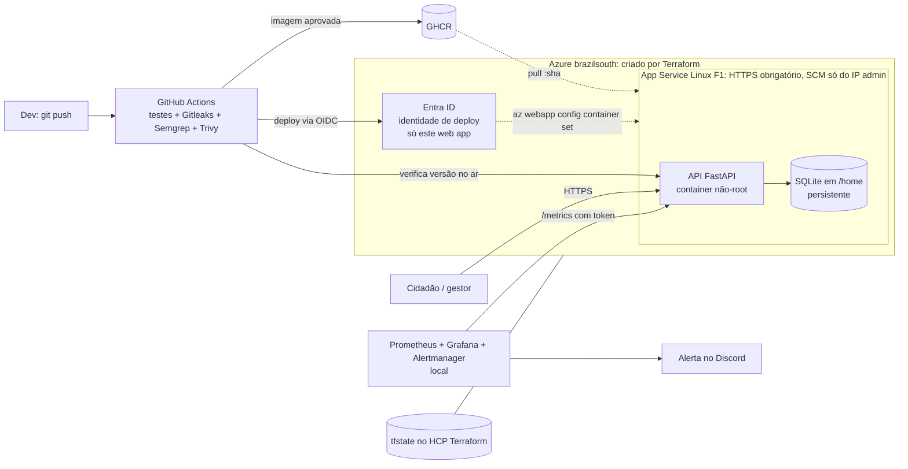

# Caminho Livre

Mapa colaborativo para identificar, organizar e acompanhar barreiras de acessibilidade em calçadas e travessias.
Global Solution FIAP 2026.2 (CitizenTech), 4ES. Este repositório traz o MVP e a entrega de **Secure DevOps Tools & Cloud Computing: Deploy Blindado**.

[](../../actions/workflows/devsecops.yml)

## Ficha Técnica do MVP

| Campo | Conteúdo |
|---|---|
| **Nome do produto** | Caminho Livre |
| **Cidadão e território** | Pedestres com deficiência ou mobilidade reduzida, idosos e cuidadores. O piloto cobre o entorno do campus FIAP Paulista (São Paulo, SP), cerca de 1,2 km × 1,5 km. |
| **Problema, em uma frase** | Rampas bloqueadas, calçadas obstruídas e travessias com barreira são relatadas de forma dispersa e ninguém acompanha se foram resolvidas. |
| **Proposta de valor** | O cidadão registra a barreira no mapa e acompanha o status. O gestor do local recebe uma fila auditável para revisar, priorizar e encerrar cada relato. |
| **Arquitetura: componentes** | Página web (HTML + Leaflet) e API FastAPI num container, publicado no Azure App Service (Linux, plano F1 gratuito) criado por Terraform. Banco SQLite no armazenamento persistente do App Service (brazilsouth). CI/CD com GitHub Actions (build, testes, Gitleaks, Semgrep e Trivy) e deploy por OIDC. Observabilidade com Prometheus, Grafana e Alertmanager. Localmente, Docker Compose (API + Caddy). |
| **Fontes de dados** | (A) OpenStreetMap: mapa base e, no componente de Big Data, a malha de calçadas e travessias. (B) Relatos enviados pelo próprio MVP. Os pontos de demonstração são **sintéticos** e vêm marcados como "demonstração". (C) Open-Meteo, opcional, no componente de Big Data. |
| **Modelos de IA utilizados** | Detector de obstáculos customizado (YOLO), do componente Applied Computer Vision. Ele **não** faz parte desta entrega de DevOps. |
| **URL do MVP e repositório** | MVP: https://caminholivre-gs.azurewebsites.net. Repositório: https://github.com/santos-nikolas/caminho-livre |
| **Indicadores de impacto** | Relatos recebidos, relatos revisados, tempo até a primeira revisão, relatos resolvidos com confirmação e taxa de resolução. São indicadores de processo: não provam melhoria física sem verificação. |
| **ODS conectados** | ODS 10 (redução das desigualdades) e ODS 11 (cidades e comunidades sustentáveis, meta 11.2/11.7: acesso seguro e inclusivo a espaços públicos). |

### Integrantes

| Nome completo | RM |
|---|---|
| Guilherme Rocha Bianchini | RM97974 |
| Nikolas Rodrigues Moura dos Santos | RM551566 |
| Thiago Jardim de Oliveira | RM551624 |
| Rodrigo Brasileiro | RM98952 |

## Arquitetura



**Por que App Service e não VM:** a assinatura da equipe (*Azure para Estudantes Starter*) só permite `Microsoft.Web`, `Microsoft.Sql` e provedores de gestão; VM, rede virtual e Storage Account são recusados (`DisallowedProvider`). O F1 é gratuito, roda o mesmo container e entrega HTTPS e patches do host pela plataforma.

## Como rodar localmente

Pré-requisito: Docker com Compose v2.

```bash
cp .env.example .env            # troque os valores
docker compose up -d --build    # api + proxy (Caddy)
# abra http://localhost:8080
```

Testes (Python 3.11+; usam um SQLite temporário, sem serviço externo):

```bash
cd app && pip install -r requirements-dev.txt && python -m pytest -q
```

## Deploy na Azure (Terraform)

Pré-requisitos: [Azure CLI](https://learn.microsoft.com/cli/azure/install-azure-cli), Terraform ≥ 1.6 e uma conta gratuita no [HCP Terraform](https://app.terraform.io) (onde fica o state).

```bash
az login
export TF_TOKEN_app_terraform_io="<token do HCP Terraform>"   # ou: terraform login
export TF_CLOUD_ORGANIZATION="<sua organizacao>" TF_WORKSPACE="caminho-livre"
cd infra/terraform
cp terraform.tfvars.example terraform.tfvars # preencha: subscription_id e admin_cidr (seu IP /32)
terraform init
terraform plan -out plano.tfplan
terraform apply plano.tfplan
terraform output app_url
```

- O **state** fica no HCP Terraform, criptografado e versionado. O workspace usa *execution mode* `local`: o plano roda na sua máquina com o seu `az login`, e só o state vai para o HCP. O `terraform.tfvars` está no `.gitignore`.
- A **porta administrativa** do App Service é o site SCM/Kudu. Ele só aceita o `admin_cidr`, e a ação padrão é negar. A validação em `variables.tf` recusa `0.0.0.0/0` e qualquer faixa maior que /24, e o `terraform test` comprova isso no CI. FTP e publicação por senha estão desligados, e não há SSH.
- Token de admin e token de métricas são gerados pelo Terraform (`random_password`) e entram como *app settings*. Nunca são digitados nem versionados.
- O Terraform cria também a **identidade de deploy** (aplicação no Entra ID com credencial federada OIDC). Ela só aceita o environment `producao` deste repositório e tem o papel *Website Contributor* só neste web app.

### Configuração do GitHub (uma vez)

```bash
gh secret set AZURE_CLIENT_ID       --body "$(terraform output -raw azure_client_id)"
gh secret set AZURE_TENANT_ID       --body "$(terraform output -raw azure_tenant_id)"
gh secret set AZURE_SUBSCRIPTION_ID --body "$(az account show --query id -o tsv)"
gh secret set METRICS_TOKEN         --body "$(terraform output -raw metrics_token)"
gh variable set APP_URL              --body "$(terraform output -raw app_url)"
gh variable set AZURE_WEBAPP_NAME    --body "$(terraform output -raw app_name)"
gh variable set AZURE_RESOURCE_GROUP --body "$(terraform output -raw resource_group)"
```

A imagem `ghcr.io/santos-nikolas/caminho-livre` é pública: ela herda a visibilidade do repositório público. Por isso o App Service puxa a imagem sem credencial.

## Pipeline DevSecOps (`.github/workflows/devsecops.yml`)

| Job | Quando | O que barra |
|---|---|---|
| Build e testes | todo push | regressão funcional (pytest com a API completa) |
| Gitleaks | todo push | segredo em **qualquer commit** do histórico |
| Semgrep | todo push | SAST: Python, Dockerfile, GitHub Actions e segredos (`--error`) |
| Terraform + Trivy (IaC) | todo push | `fmt`/`validate`/`test` + misconfiguração HIGH/CRITICAL |
| Imagem + Trivy | todo push | CVE HIGH/CRITICAL corrigível ou segredo na imagem. Na `main`, publica no GHCR |
| Deploy automático | push na `main` | falha se a nova versão não estiver no ar em 10 min ou se `/metrics` não exigir token |

**Deploy:** só a imagem aprovada em todos os portões é publicada.
1. O job `deploy` faz login na Azure por **OIDC**, com um token de curta duração emitido para o environment `producao`. Não há senha nem chave da nuvem guardada no GitHub.
2. O job aponta o App Service para a imagem `:<sha>` do commit.
3. O job só passa quando `/health` responde com esse SHA.

### Demonstrar uma execução barrada e a corrigida

```bash
git switch -c demo/segredo-vazado
echo "DATABASE_PASSWORD = \"$(openssl rand -base64 18)\"" > app/config_demo.py   # segredo FALSO gerado na hora
git add . && git commit -m "demo: segredo vazado" && git push -u origin demo/segredo-vazado
# → job Gitleaks falha (print da execução barrada)
git reset --hard HEAD~1 && git push --force          # correção: remove o segredo do HISTÓRICO
# → pipeline verde (print da execução corrigida); depois apague a branch
```

Execuções reais desta demonstração: [barrada](https://github.com/santos-nikolas/caminho-livre/actions/runs/43145312127) e [corrigida](https://github.com/santos-nikolas/caminho-livre/actions/runs/43145405668).

## Observabilidade (`monitoring/`)

Prometheus, Grafana e Alertmanager rodam **localmente** e raspam o MVP publicado (o enunciado permite):

```bash
cd monitoring
terraform -chdir=../infra/terraform output -raw metrics_token > secrets/metrics_token
echo "https://discord.com/api/webhooks/..." > secrets/discord_webhook   # webhook de um canal da equipe
GRAFANA_ADMIN_PASSWORD='<senha-forte>' docker compose up -d
```

- Grafana: http://localhost:3000, dashboard **Caminho Livre - 4 sinais de ouro**: latência (p50/p95/p99), tráfego (req/s por rota), erros (4xx/5xx e % de 5xx) e saturação (CPU, memória, requisições em andamento).
- Alertas (`alertas.yml`): `CaminhoLivreFora`, `TaxaDeErrosAlta` (>5% de 5xx), `LatenciaP95Alta` (>1 s) e `SaturacaoMemoria` (>200 MB).
- **Disparar um alerta de verdade:** rode `az webapp stop -g rg-caminholivre -n caminholivre-gs`. A raspagem falha, o `CaminhoLivreFora` vai para *firing* em cerca de 1 min e a mensagem chega ao Discord. Depois, rode `az webapp start ...` e o alerta é resolvido.

## Segurança e LGPD (resumo)

- **Container:** imagem multi-stage, usuário não-root (uid 10001), sem segredo na imagem (o Trivy `secret` confirma). No compose local: sistema de arquivos read-only, `cap_drop: ALL`, `no-new-privileges` e limite de memória.
- **Nuvem:** HTTPS obrigatório com TLS 1.2+. O SCM/Kudu só aceita o IP do admin. FTP e publicação por senha estão desligados. O deploy usa OIDC com menor privilégio.
- **App:** CSP restritiva e `nosniff`. A rota de admin e o `/metrics` exigem token Bearer, comparado em tempo constante. A documentação OpenAPI está desligada.
- **Dados pessoais:** não há contas de cidadão. A coordenada é arredondada (~11 m), e e-mail, telefone e CPF são removidos do texto livre antes de gravar. O banco fica em `/home/data` do App Service, em `brazilsouth` (Brasil). Os logs HTTP da plataforma guardam o IP por 7 dias; a API não grava IP nem corpo de requisição.

## Estrutura

```
app/                 API FastAPI, página web, testes e Dockerfile
docker-compose.yml   stack local (api + proxy); override adiciona o build
infra/terraform/     App Service, restrições de acesso e identidade OIDC (Azure) + testes de segurança
monitoring/          Prometheus, alertas, Alertmanager e Grafana
.github/workflows/   pipeline DevSecOps
docs/                relatório (PDF) e evidências
```

### Gerar o PDF do relatório

Salve os prints em `docs/evidencias/` com os nomes indicados nas figuras de `docs/relatorio.html`. Preencha os nomes, RMs e links e rode (Windows/PowerShell):

```powershell
& "C:\Program Files (x86)\Microsoft\Edge\Application\msedge.exe" --headless=new --no-pdf-header-footer --virtual-time-budget=5000 `
  --print-to-pdf="$PWD\docs\relatorio-deploy-blindado.pdf" "file:///$($PWD -replace '\\','/')/docs/relatorio.html"
```

Figuras sem print aparecem como uma caixa amarela "PRINT PENDENTE".
