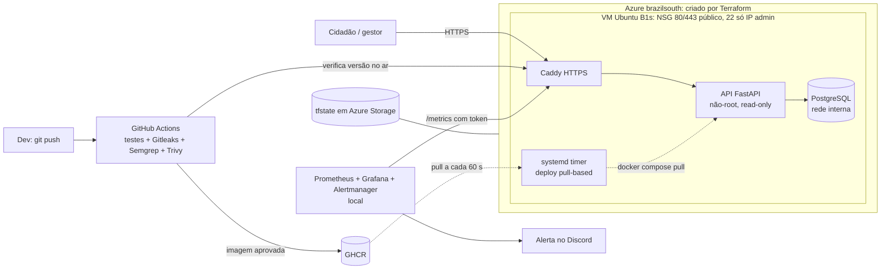

# Caminho Livre

Mapa colaborativo para identificar, organizar e acompanhar barreiras de acessibilidade em calçadas e travessias.
Global Solution FIAP 2026.2 (CitizenTech), 4ES. Este repositório traz o MVP e a entrega de **Secure DevOps Tools & Cloud Computing: Deploy Blindado**.

[](../../actions/workflows/devsecops.yml)

## Ficha Técnica do MVP

| Campo | Conteúdo |
|---|---|
| **Nome do produto** | Caminho Livre |
| **Cidadão e território** | Pedestres com deficiência ou mobilidade reduzida, idosos e cuidadores. O piloto cobre o entorno do campus FIAP Paulista (São Paulo, SP), cerca de 1,2 km × 1,5 km. |
| **Problema, em uma frase** | Rampas bloqueadas, calçadas obstruídas e travessias com barreira são relatadas de forma dispersa e ninguém acompanha se foram resolvidas. |
| **Proposta de valor** | O cidadão registra a barreira no mapa e acompanha o status. O gestor do local recebe uma fila auditável para revisar, priorizar e encerrar cada relato. |
| **Arquitetura: componentes** | Página web (HTML + Leaflet), API FastAPI, PostgreSQL e Caddy (HTTPS), rodando em Docker Compose numa VM Azure criada por Terraform. CI/CD com GitHub Actions (build, testes, Gitleaks, Semgrep e Trivy). Observabilidade com Prometheus, Grafana e Alertmanager. |
| **Fontes de dados** | (A) OpenStreetMap: mapa base e, no componente de Big Data, a malha de calçadas e travessias. (B) Relatos enviados pelo próprio MVP. Os pontos de demonstração são **sintéticos** e vêm marcados como "demonstração". (C) Open-Meteo, opcional, no componente de Big Data. |
| **Modelos de IA utilizados** | Detector de obstáculos customizado (YOLO), do componente Applied Computer Vision. Ele **não** faz parte desta entrega de DevOps. |
| **URL do MVP e repositório** | MVP: `https://caminholivre-gs.brazilsouth.cloudapp.azure.com` *(preencher com o `app_url` do Terraform)*. Repositório: *(link deste repositório)* |
| **Indicadores de impacto** | Relatos recebidos, relatos revisados, tempo até a primeira revisão, relatos resolvidos com confirmação e taxa de resolução. São indicadores de processo: não provam melhoria física sem verificação. |
| **ODS conectados** | ODS 10 (redução das desigualdades) e ODS 11 (cidades e comunidades sustentáveis, meta 11.2/11.7: acesso seguro e inclusivo a espaços públicos). |

### Integrantes

| Nome completo | RM |
|---|---|
| *(preencher)* | *(preencher)* |
| *(preencher)* | *(preencher)* |
| *(preencher)* | *(preencher)* |

## Arquitetura



## Como rodar localmente

Pré-requisito: Docker com Compose v2.

```bash
cp .env.example .env            # troque os valores
docker compose up -d --build    # db + api + proxy
# abra http://localhost:8080
```

Testes (exigem o Postgres do compose rodando):

```bash
docker run --rm --network caminho-livre_default -v "$PWD/app:/src" -w /src \
  -e DATABASE_URL=postgresql://caminholivre:<POSTGRES_PASSWORD>@db:5432/caminholivre \
  python:3.12-slim sh -c "pip install -q -r requirements-dev.txt && python -m pytest -q"
```

## Deploy na Azure (Terraform)

Pré-requisitos: [Azure CLI](https://learn.microsoft.com/cli/azure/install-azure-cli), Terraform ≥ 1.6, chave SSH (`ssh-keygen -t ed25519`).

```bash
az login
bash infra/bootstrap/criar-state.sh          # 1x: Storage Account do tfstate + backend.hcl
cd infra/terraform
cp terraform.tfvars.example terraform.tfvars # preencha: subscription_id, admin_cidr (seu IP /32), api_image
terraform init -backend-config=backend.hcl
terraform plan -out plano.tfplan
terraform apply plano.tfplan
terraform output app_url
```

- O **state** fica em Azure Storage, com versionamento, TLS 1.2 e sem acesso público. O `terraform.tfvars` e o `backend.hcl` estão no `.gitignore`.
- O **SSH** só aceita o `admin_cidr`. A validação em `variables.tf` recusa `0.0.0.0/0` e qualquer faixa maior que /24, e o `terraform test` comprova isso no CI.
- Senha do banco, token de admin e token de métricas são gerados pelo Terraform (`random_password`) e gravados num `.env` com modo 0600 na VM. Nunca são digitados nem versionados.

### Configuração do GitHub (uma vez)

```bash
gh secret set METRICS_TOKEN --body "$(terraform output -raw metrics_token)"
gh variable set APP_URL --body "$(terraform output -raw app_url)"
```

Depois do primeiro push na `main`, deixe a imagem pública: GitHub → Packages → `caminho-livre` → Package settings → Change visibility → Public. A VM puxa sem credencial.

## Pipeline DevSecOps (`.github/workflows/devsecops.yml`)

| Job | Quando | O que barra |
|---|---|---|
| Build e testes | todo push | regressão funcional (pytest com Postgres real) |
| Gitleaks | todo push | segredo em **qualquer commit** do histórico |
| Semgrep | todo push | SAST: Python, Dockerfile, GitHub Actions e segredos (`--error`) |
| Terraform + Trivy (IaC) | todo push | `fmt`/`validate`/`test` + misconfiguração HIGH/CRITICAL |
| Imagem + Trivy | todo push | CVE HIGH/CRITICAL corrigível ou segredo na imagem. Na `main`, publica no GHCR |
| Deploy automático | push na `main` | falha se a nova versão não estiver no ar em 5 min ou se `/metrics` não exigir token |

**Deploy pull-based:** só a imagem aprovada em todos os portões recebe a tag `latest`. Na VM, um `systemd timer` roda `docker compose pull && up -d` a cada 60 s, e o job `deploy` só passa quando `/health` responde com o SHA do commit. Com isso, o CI não guarda credencial da nuvem nem precisa de SSH aberto para a internet.

### Demonstrar uma execução barrada e a corrigida

```bash
git switch -c demo/segredo-vazado
echo "DATABASE_PASSWORD = \"$(openssl rand -base64 18)\"" > app/config_demo.py   # segredo FALSO gerado na hora
git add . && git commit -m "demo: segredo vazado" && git push -u origin demo/segredo-vazado
# → job Gitleaks falha (print da execução barrada)
git reset --hard HEAD~1 && git push --force          # correção: remove o segredo do HISTÓRICO
# → pipeline verde (print da execução corrigida); depois apague a branch
```

## Observabilidade (`monitoring/`)

Prometheus, Grafana e Alertmanager rodam **localmente** e raspam o MVP publicado (o enunciado permite):

```bash
cd monitoring
terraform -chdir=../infra/terraform output -raw metrics_token > secrets/metrics_token
echo "https://discord.com/api/webhooks/..." > secrets/discord_webhook   # webhook de um canal da equipe
GRAFANA_ADMIN_PASSWORD='<senha-forte>' docker compose up -d
```

- Grafana: http://localhost:3000, dashboard **Caminho Livre - 4 sinais de ouro**: latência (p50/p95/p99), tráfego (req/s por rota), erros (4xx/5xx e % de 5xx) e saturação (CPU, memória, requisições em andamento).
- Alertas (`alertas.yml`): `CaminhoLivreFora`, `TaxaDeErrosAlta` (>5% de 5xx), `LatenciaP95Alta` (>1 s) e `SaturacaoMemoria` (>200 MB).
- **Disparar um alerta de verdade:** na VM, `sudo docker compose -f /opt/caminho-livre/docker-compose.yml stop db` e navegue no site por cerca de 2 min. A API responde 500, o `TaxaDeErrosAlta` dispara e a mensagem chega ao Discord. Depois, `start db` e o alerta é resolvido.

## Segurança e LGPD (resumo)

- Container: imagem multi-stage, usuário não-root (uid 10001), sistema de arquivos read-only, `cap_drop: ALL`, `no-new-privileges`, limite de memória, sem segredo na imagem (Trivy `secret` confirma).
- Rede: só 80/443 públicos. O Postgres não publica porta e o SSH só aceita o IP do admin.
- App: CSP restritiva, `nosniff`, rota de admin e `/metrics` com token Bearer (comparação em tempo constante), documentação OpenAPI desligada em produção.
- Dados pessoais: sem contas de cidadão. A coordenada é arredondada (~11 m), e e-mail, telefone e CPF são removidos do texto livre antes de gravar. Os dados ficam só no volume Postgres da VM em `brazilsouth` (Brasil). Os logs não guardam o corpo das requisições.

## Estrutura

```
app/                 API FastAPI, página web, testes e Dockerfile
docker-compose.yml   stack (local e produção); override só local
infra/terraform/     VM, rede, NSG e IP (Azure) + testes de segurança
infra/bootstrap/     criação do state remoto
monitoring/          Prometheus, alertas, Alertmanager e Grafana
.github/workflows/   pipeline DevSecOps
docs/                relatório (PDF) e evidências
```

### Gerar o PDF do relatório

Salve os prints em `docs/evidencias/` com os nomes indicados nas figuras de `docs/relatorio.html`. Preencha os nomes, RMs e links e rode (Windows/PowerShell):

```powershell
& "C:\Program Files (x86)\Microsoft\Edge\Application\msedge.exe" --headless=new --no-pdf-header-footer --virtual-time-budget=5000 `
  --print-to-pdf="$PWD\docs
elatorio-deploy-blindado.pdf" "file:///$($PWD -replace '\','/')/docs/relatorio.html"
```

Figuras sem print aparecem como uma caixa amarela "PRINT PENDENTE".
